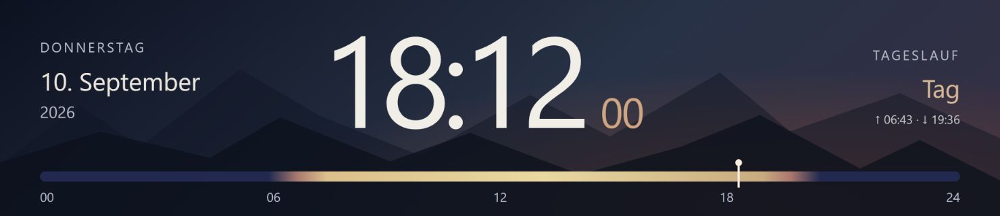
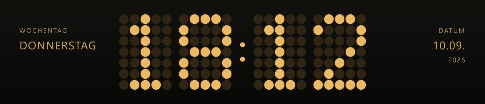
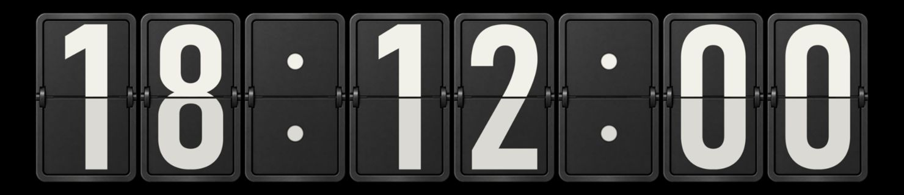
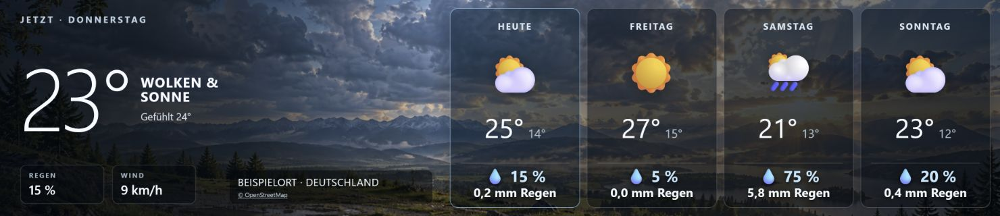
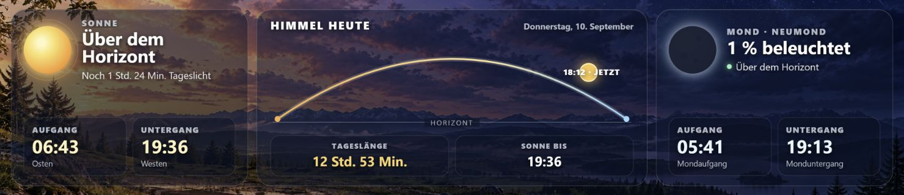
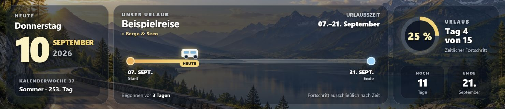

# Camper-Display

Modulare Uhr- und Informationsanzeige für den Camper: Python/FastAPI im Backend,
HTML/CSS/JavaScript im Chromium-Kiosk. Zielgerät ist ein Raspberry Pi 3 mit DietPi
und einem Touchdisplay mit 1480 × 320 Pixeln.

Enthalten sind verschiedene Uhrdesigns, Wetter und Himmel, Datum/Urlaub mit
Kalenderanbindung, Karte, Traccar-Fahrt, Ankunftsanzeige, Nachtmodus und der
Bilderrahmen „Reisemomente“ mit lokaler Fotoverwaltung.

## Beispiel-Screenshots

Aufgenommen mit den aktuellen Produktionsrenderern bei 1480 × 320 Pixeln.
Datum, Uhrzeit, Wetter und Reiseangaben sind feste Beispieldaten; die Bilder
zeigen keine persönlichen Reisen oder Live-Standorte.

**Panorama-Uhr**

**Bahnhofs-LED**

**Flip-Uhr**

**Wetter**

**Himmel**

**Datum und Urlaub**

**Reisemomente**

Die [Screenshot-Dokumentation](camper-uhr/docs/screenshots/README.md) beschreibt
die reproduzierbare Vorschau und ihre Bildquellen.

## Einstieg

- [Lokale Installation, Start und Tests](camper-uhr/README.md)
- [Aktueller Arbeitsstand und Übergabe](UEBERGABE.md)
- [Anforderungen](camper-uhr/docs/PFLICHTENHEFT.md)
- [Architektur](camper-uhr/ARCHITECTURE.md)
- [Einstellungen](camper-uhr/docs/SETTINGS.md)
- [Uhrmodule](camper-uhr/docs/CLOCK_MODULES.md)
- [Bilderrahmen und Fotos](camper-uhr/docs/PHOTO_FRAME.md)
- [Karte und Navigation](camper-uhr/docs/MAP_NAVIGATION.md)
- [Traccar](camper-uhr/docs/TRACCAR.md)
- [Ankunftsanzeige](camper-uhr/docs/ARRIVAL_MODE.md)
- [Nachtmodus](camper-uhr/docs/NIGHT_MODE.md)
- [Wetter und Standort](camper-uhr/docs/WEATHER_LOCATION.md)
- [Installation auf DietPi](camper-uhr/deploy/DIETPI.md)
- [Sicherung und Wiederherstellung](camper-uhr/docs/BACKUP.md)

Der Quellcode liegt aus Kompatibilitätsgründen weiterhin in `camper-uhr/`.
Teile der Moduldokumentation beschreiben ältere Entwicklungsstände;
maßgeblich sind der aktuelle Code, die Installationsanleitung und die Übergabe.

## Umfang des Repositorys

Dieses Repository enthält Quellcode, Anwendungsassets, Tests, Vorschauen und
Projektdokumentation. Private Datenbanken, Zugangsdaten, Kalender-Freigabelinks,
hochgeladene Reisefotos, Gesprächsarchive, virtuelle Umgebungen und alte
Release-Pakete sind nicht enthalten.

Einstellungen und Zugänge müssen bei einer neuen Installation separat
eingerichtet werden. Git ersetzt keine Sicherung der privaten Laufzeitdaten.
Vor Änderungen am Pi immer den aktuellen Zugang und Systemzustand prüfen;
keine automatischen Systemupdates und keine ungeprüfte Übernahme von Datenbanken.

Die Anwendung ist für das vertrauenswürdige Camper-LAN vorgesehen und hat keine
Benutzeranmeldung. Keine direkte Freigabe ins Internet; siehe [SECURITY.md](SECURITY.md).

## Lizenz

Eigener Code und Dokumentation: **GNU GPLv3 (GPL-3.0-only)**.
Bei Weitergabe gelten die Pflichten zur Bereitstellung des zugehörigen Quellcodes
unter derselben Lizenz. Kommerzielle Nutzung ist erlaubt. Es wird keine Garantie
übernommen; siehe den vollständigen Text in [LICENSE](LICENSE).

Fremdbilder, Bibliotheken und Daten behalten ihre eigenen Lizenzen und
Quellenhinweise: [THIRD_PARTY_NOTICES.md](THIRD_PARTY_NOTICES.md).
